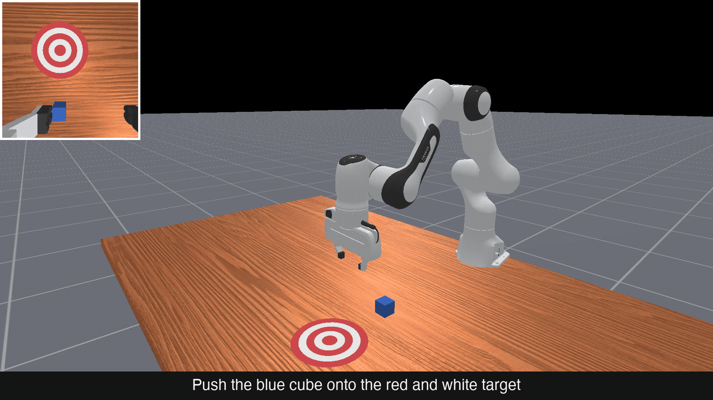
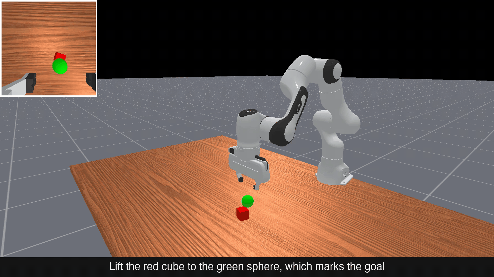
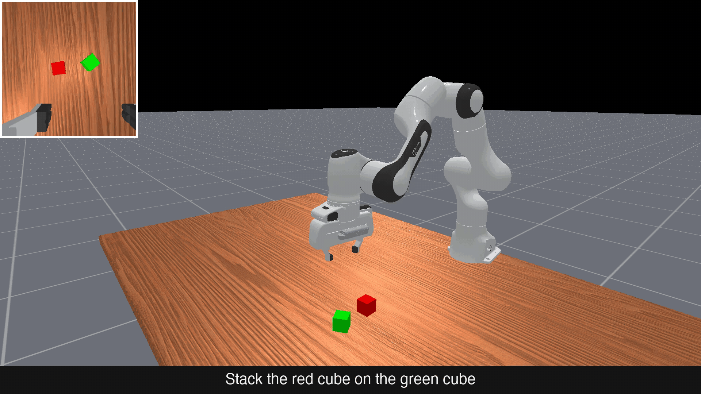
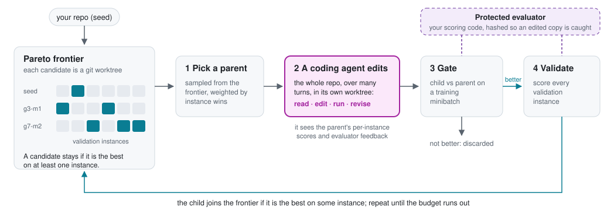

<div align="center">

<h1>
<picture>
  <source media="(prefers-color-scheme: dark)" srcset="docs/assets/logo/helix-wordmark-dark.svg">
  
</picture>
</h1>

### 🧬 Evolve whole codebases with coding agents

[](LICENSE) [](https://www.python.org/downloads/) [](https://pypi.org/project/helix-evo/) [](https://github.com/KE7/helix/actions/workflows/ci.yml)

[Docs](https://ke7.github.io/helix/) · [Quickstart](#quickstart) · [Results](#results) · [Built with HELIX](#built-with-helix) · [Examples](#examples)

</div>

<table align="center">
  <tr><th></th><th>Seed</th><th>Evolved by HELIX</th></tr>
  <tr>
    <td><b>Push</b></td>
    <td></td>
    <td></td>
  </tr>
  <tr>
    <td><b>Pick</b></td>
    <td></td>
    <td></td>
  </tr>
  <tr>
    <td><b>Stack</b></td>
    <td></td>
    <td></td>
  </tr>
</table>

<p align="center"><sub>One HELIX mutation by Claude Sonnet rewrote a Franka Panda solver package on ManiSkill 3: validation went from 0.064 to 1.0, and the evolved package solves all 141 train, validation and held-out trials. Validation trial 26 of each task, wrist camera top left. <a href="https://ke7.github.io/helix/experiments/maniskill-pick-place.html">Write-up</a></sub></p>

HELIX optimizes a whole repository against your evaluator. Each mutation is a multi-turn session of a coding agent (Claude Code, Codex, Cursor, OpenCode or Antigravity) that reads, edits, runs and tests code in its own git worktree before HELIX scores the result. Candidates are kept on an instance-level Pareto frontier, so a program that is best on any one case survives. The search loop comes from GEPA's [optimize_anything](https://doi.org/10.1145/3786335.3813167).

Unlike a single coding-agent session, HELIX keeps going: it runs many attempts against a scorer you control, keeps only changes that measurably help, and hands back plain code. You provide a repository, an objective, and an evaluator that prints a score per case.

## Results

| | |
|---|---|
| **0.064 → 1.0** | ManiSkill push, pick and stack: one Claude Sonnet mutation (40 s of agent time, $0.14) solves all 141 trials, including 90 held out. [Write-up](https://ke7.github.io/helix/experiments/maniskill-pick-place.html) |
| **99.0%** | [RHO](https://rho-robotics.github.io/) on Robosuite: HELIX-evolved robot-policy repositories reach 99.0% single-turn success (693/700), against CaP-Agent0's 68.29% with multi-turn correction. |
| **12.2× faster** | RHO's evolved repositories run as fixed code with no LLM calls in the control loop: 9.31 s per trial, against CaP-Agent0's 113.6 s. |

## Built with HELIX

| Paper | Venue | How HELIX is used | Links |
|---|---|---|---|
| **RHO: Your Coding Agent is Secretly a Roboticist** | [Sim2Real2Field Workshop @ CoRL 2026](https://sim2real2field-corl26.github.io/) · [Lifelong Agents Workshop @ COLM 2026](https://lifelongagent.github.io/) | HELIX evolves multi-file robot-policy repositories in simulation; the result ships as fixed code | [Paper](https://arxiv.org/abs/2606.16458) · [Project page](https://rho-robotics.github.io/) |

Using HELIX in a paper or project? Open a pull request to add it here.

## Quickstart

```bash
pip install helix-evo
cd your-project/
helix init          # writes helix.toml; set your objective and evaluator command
```

HELIX scores a candidate by running your evaluator, which prints one `HELIX_RESULT=` line:

```python
# evaluate.py
import json
score, feedback = run_my_benchmark()  # your code
print("HELIX_RESULT=" + json.dumps([[score, {"feedback": feedback}]]))
```

```bash
helix evolve        # run the search
helix frontier      # candidates on the Pareto frontier
helix best --export ./best
```

HELIX never touches your branch, HEAD or remote: every candidate lives in a detached worktree under `.helix/worktrees/`. For a first run, turn on the [Docker sandbox](https://ke7.github.io/helix/getting-started/quickstart.html#recommended-sandbox-the-agent). The [docs](https://ke7.github.io/helix/) cover [writing an evaluator](https://ke7.github.io/helix/getting-started/evaluator.html), [configuration](https://ke7.github.io/helix/guides/configuration.html) and the [CLI](https://ke7.github.io/helix/reference/cli.html).

## Examples

| Example | What HELIX evolves | Result | Checked by |
|---|---|---|---|
| [`maniskill_pick_place`](examples/maniskill_pick_place/) | A multi-file `solver/` package that drives a Franka Panda through push, pick and stack in ManiSkill 3 | 0.064 → 1.0 validation in one mutation ([write-up](https://ke7.github.io/helix/experiments/maniskill-pick-place.html)) | 90 held-out trials the agent never sees |
| [`circle_packing`](examples/circle_packing/) | optimize_anything's circle-packing seed code and refiner prompt: pack 26 circles in the unit square | [Write-up](https://ke7.github.io/helix/experiments/circle-packing.html) | GEPA's own fitness function |
| [`web_researcher`](examples/web_researcher/) | A question-answering agent for software questions whose answers change over time | Run it to produce results | Versions fetched live from PyPI and endoflife.date at scoring time |

## How it works

<p align="center">
<picture>
  <source media="(prefers-color-scheme: dark)" srcset="docs/assets/helix-loop-dark.svg">
  
</picture>
</p>

More in [How HELIX works](https://ke7.github.io/helix/concepts/how-it-works.html).

## Related work

- **GEPA optimize_anything** ([Agrawal et al., CAIS 2026](https://doi.org/10.1145/3786335.3813167)) optimizes any text parameter with reflective Pareto search. HELIX ports its search loop and makes the candidate a whole repository, mutated by a coding agent.
- **Meta-Harness** ([Lee et al., 2026](https://arxiv.org/abs/2603.28052)), concurrent work, uses a coding-agent proposer to optimize a single-file harness program, not a repository.
- **OpenEvolve** and **ShinkaEvolve** evolve a program, typically the code inside marked blocks, with LLM-written diffs.
- **SkyDiscover** evolves programs with AdaEvolve and EvoX, and its Synthesize mode has coding agents build complete systems from a spec.

## Citation

```bibtex
@software{helix2026,
  title  = {HELIX: Hierarchical Evolution via LLM-Informed eXploration},
  author = {Elmaaroufi, Karim},
  year   = {2026},
  url    = {https://github.com/KE7/helix}
}
```

## Acknowledgments

HELIX's search algorithm is GEPA optimize_anything's, by Agrawal, Lee, Tan, Ma, Elmaaroufi, Sandadi, Seshia, Sen, Klein, Stoica, Gonzalez, Khattab, Dimakis and Zaharia ([paper](https://doi.org/10.1145/3786335.3813167), [arXiv](https://arxiv.org/abs/2605.19633)). The mutation backends are [Antigravity CLI](https://antigravity.google/cli), [Claude Code](https://docs.anthropic.com/en/docs/claude-code), [Codex CLI](https://developers.openai.com/codex/cli), [Cursor CLI](https://cursor.com/cli/) and [OpenCode](https://opencode.ai/docs/cli/). HELIX was built with [OMAR](http://omar.tech/).

<details>
<summary>BibTeX for optimize_anything and Meta-Harness</summary>

```bibtex
@inproceedings{agrawal2026optimizeanything,
  title         = {optimize\_anything: Unified Text Optimization can Outperform Specialized Systems},
  author        = {Agrawal, Lakshya A and Lee, Donghyun and Tan, Shangyin and Ma, Wenjie and Elmaaroufi, Karim and Sandadi, Rohit and Seshia, Sanjit A. and Sen, Koushik and Klein, Dan and Stoica, Ion and Gonzalez, Joseph E. and Khattab, Omar and Dimakis, Alexandros G. and Zaharia, Matei},
  booktitle     = {Proceedings of the ACM Conference on AI and Agentic Systems (CAIS '26)},
  address       = {San Jose, CA, USA},
  publisher     = {ACM},
  month         = may,
  year          = {2026},
  pages         = {1--16},
  doi           = {10.1145/3786335.3813167},
  eprint        = {2605.19633},
  archiveprefix = {arXiv},
  primaryclass  = {cs.CL},
  note          = {arXiv version titled ``optimize\_anything: A Universal API for Optimizing any Text Parameter''}
}

@article{lee2026metaharness,
  title         = {Meta-Harness: End-to-End Optimization of Model Harnesses},
  author        = {Lee, Yoonho and Nair, Roshen and Zhang, Qizheng and Lee, Kangwook and Khattab, Omar and Finn, Chelsea},
  journal       = {arXiv preprint arXiv:2603.28052},
  year          = {2026},
  eprint        = {2603.28052},
  archiveprefix = {arXiv},
  primaryclass  = {cs.AI}
}
```

</details>

## License

BSD 3-Clause. See [LICENSE](LICENSE).
