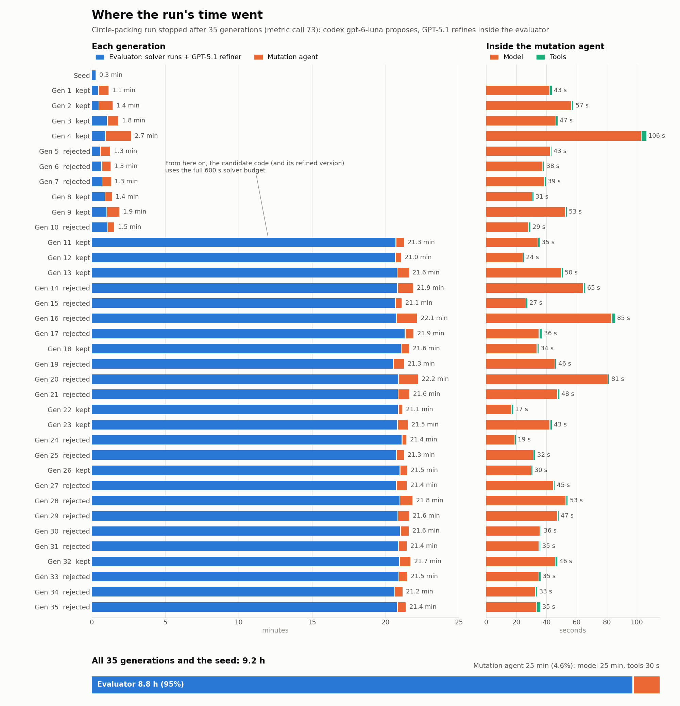

# 🔵 Circle Packing Experiment

> **Objective:** Pack 26 non-overlapping circles in a unit square, maximizing the sum of radii.

---

## Overview

This is optimize_anything's circle-packing experiment, the one behind its
published result, run by HELIX. Everything that decides a score comes from
[gepa-ai/gepa@133d185a `examples/circle_packing`](https://github.com/gepa-ai/gepa/tree/133d185a/examples/circle_packing):
the seed, the candidate interface, the validity rule, the scoring, the GPT-5.1
refiner, the StateTracker with its caches and warm start, the objective and
background text, and the budget. The search algorithm is GEPA's, as HELIX
implements it. Only the proposer is different: HELIX's mutation agent, Claude
Haiku 4.5 in Claude Code, edits the candidate where GEPA's reflection LM, GPT-5,
proposes new text (see [Comparison limits](#comparison-limits)).

The experiment is [`examples/circle_packing/`](../../examples/circle_packing/).
Its mutation agent runs in HELIX's Docker sandbox with no web access, on the
network that [`examples/circle_packing_sandbox/`](../../examples/circle_packing_sandbox/)
provides (see [Agent sandbox](#agent-sandbox)). The evaluator runs on the host,
as optimize_anything's did.

One run is recorded, with a different proposer from the one configured here:
Codex `gpt-6-luna` on the host, with GEPA's GPT-5.1 refiner. It reached
2.6359830847 and first passed 2.63598 at metric call 23 (optimize_anything:
call 63). optimize_anything's final 2.6359833626 is higher only through the
validator's `1e-6` overlap tolerance; with no tolerance, this run's packing is
the larger. See [Recorded run](#recorded-run).

---

## The experiment

### Candidate

A candidate has GEPA's two components, each in a file:

| Component | File | Seed |
|---|---|---|
| `code` | `solve.py` | GEPA's `SEED_CODE`, byte for byte |
| `refiner_prompt` | `refiner_prompt.txt` | GEPA's `SEED_REFINEMENT_PROMPT`, byte for byte |

`solve.py` defines `main(timeout, current_best_solution)` and returns
`{'circles': <(26, 3) array of (x, y, r)>, 'all_scores': [...]}`.
`current_best_solution` is the best packing found so far in the run, or `None`.
The seed places one circle at the center, a ring of 8 around it and the rest on
an outer ring, then shrinks radii greedily; it scores **0.979764**, the 0.98 of
the blog's trajectory figure. With a warm start it returns the best packing
unchanged. No other file of the candidate is evaluated.

### Fitness function

`examples/circle_packing/gepa_fitness.py` is GEPA's fitness function with only
the plumbing changed. For every candidate:

1. The StateTracker answers from its cache if this `code` has run before.
   Otherwise `code` runs in a fresh Python subprocess, executed as GEPA's
   subprocess executor does (a `__main__` namespace, `main(timeout=600,
   current_best_solution=...)`), with a 600-second limit.
2. `validate_packing` (`atol=1e-6`) checks the returned circles: shape `(26, 3)`,
   no NaN, no negative radius, every circle inside the square, no two
   overlapping. A valid packing scores the **raw sum of its radii**; an invalid
   packing, an exception or a timeout scores **0**.
3. If this `(code, refiner_prompt)` pair has not been refined before, the
   refiner, `dspy.Predict(RefinerSignature)` on `openai/gpt-5.1` (temperature
   1.0, 32,000 tokens), gets `refiner_prompt.txt`, the code and the code's
   results, and returns rewritten code, which runs and is scored the same way.
4. The candidate scores the better of the two. `side_info` is GEPA's: per
   component scores, the code, circles, stdout and errors.
   `side_info["scores"]` holds `best_score_from_code_and_refiner`,
   `initial_code` and `refiner_prompt`, the objectives of the frontier.

Every executed program that beats the run's best becomes the next
`current_best_solution`. The StateTracker's metric calls count executions of
candidate or refined code. GEPA's `state_tracker_logs.json` records them with
the code behind the best packing.

The plumbing that differs: HELIX starts the evaluator once per request, so the
StateTracker is saved to disk after every change. A candidate subprocess
reports its return value as JSON rather than a pickle. dspy is pinned to
3.1.2, its last release before the reference commit.

### Configuration

| | optimize_anything (`main.py`) | HELIX (`helix.toml`) |
|---|---|---|
| Objective | "Optimize circle packing code and refiner prompt to maximize sum of circle radii within a unit square for N=26 circles." | same text |
| Background | `CIRCLE_PACKING_BACKGROUND` | same text, plus one paragraph naming the two files |
| Budget | `max_metric_calls=200` | `max_evaluations = 200` |
| Evaluation cache | `cache_evaluation=True` | `cache_evaluation = true` |
| Frontier | `frontier_type="objective"` | `frontier_type = "objective"` |
| Minibatch | `reflection_minibatch_size=1` | `minibatch_size = 1`, one task (`train_size = val_size = 1`) |
| Candidate selection | Pareto (default) | `"pareto"` |
| Merge | none (default) | `merge_enabled = false` |
| Perfect-score skip | off (default) | no `perfect_score_threshold` |
| Proposer | `reflection_lm="openai/gpt-5"`, round-robin over components | HELIX mutation agent: Claude Code on `claude-haiku-4-5`, 40 turns |

HELIX's `max_evaluations` counts the same metric calls as GEPA's
`max_metric_calls`; `max_generations = 1000` is only a guard, because every
generation spends at least one evaluation.

### Environment

`requirements.in` is the environment of optimize_anything's published run
([`acm_cais_artifact_evaluation/domains/circle_packing/requirements.txt`](https://github.com/gepa-ai/optimize-anything-artifact/tree/58cdf89d/acm_cais_artifact_evaluation/domains/circle_packing)
of the artifact), plus the refiner's dspy. `requirements.txt` resolves it with
the packages published by the artifact's commit date (Python 3.11). Candidate
code runs with exactly these packages, as GEPA's did, so the background's
advice to use optuna, scipy or any other package refers to the same
environment.

---

## Reference values

| Source | Sum of radii (n=26) | Notes |
|---|:---:|---|
| Best known packing | 2.63598+ | [Erich Friedman's Packing Center](https://erich-friedman.github.io/packing/cirRsqu/) |
| optimize_anything | 2.635983362593453 | The published run's StateTracker log (`state_tracker_logs.json` of the [artifact](https://github.com/gepa-ai/optimize-anything-artifact/tree/58cdf89d/acm_cais_artifact_evaluation/domains/circle_packing/logs)): first ≥ 2.63598 at metric call 63, final best at 114, 133 metric calls in total |
| AlphaEvolve | 2.635 | [AlphaEvolve results notebook](https://github.com/google-deepmind/alphaevolve_results/blob/main/mathematical_results.ipynb), section B.12 |
| HELIX ([recorded run](#recorded-run)) | 2.635983084711534 | Codex `gpt-6-luna` proposer, GPT-5.1 refiner: first ≥ 2.63598 at metric call 23, final best at 54, stopped by hand at 73 |

These are best known values, not proven optima. optimize_anything's value
uses the validator's tolerance: its packing overlaps by up to 9.6e-8, and
without overlaps the same centers give at most 2.6359828435 (see
[Tolerance](#tolerance)). The
[paper](https://arxiv.org/abs/2605.19633) reports 2.63598+; its controlled
comparison reaches 2.63598 in 63 evaluations for about $3.18.

[`circle-packing/reference_known_best.py`](circle-packing/reference_known_best.py)
is a supplied packing (radius sum 2.635982) with the experiment's interface. It
checks an evaluator installation; it performs no search and is never a seed:

```bash
cd "$(git rev-parse --show-toplevel)/examples/circle_packing"
uv run --no-project --python 3.11 --with-requirements requirements.txt python3 -c \
  "import gepa_fitness as g; r = g.execute_code(open('../../docs/experiments/circle-packing/reference_known_best.py').read(), 600); print(r['success'], r['result']['validation_details']['sum_radii'])"
# True 2.6359815211
```

---

## Recorded run

One run, on 2026-10-27, with HELIX at `main` 8b9efc1 plus this experiment.
It is not the configuration above: the proposer is OpenAI's small model in
its own harness rather than Claude Haiku in Claude Code, so it ran outside the
agent sandbox. Everything that decides a score is the experiment's.

| | This run | `helix.toml` as committed |
|---|---|---|
| Proposer | Codex `gpt-6-luna`, on the host | Claude Code `claude-haiku-4-5`, in the agent sandbox |
| No web | `web_access = false` (Codex gets `web_search="disabled"`, `features.apps=false`), plus `--ignore-user-config` so no user plugins or MCP servers load | `web_access = false` and the gateway network |
| Refiner | GEPA's `make_refiner` on `openai/gpt-5.1`, reached through Arena's OpenAI-compatible API (`api_base="https://api.arena.ai/v1"`) | the same, through OpenAI |
| Budget | 200 metric calls, with `stop_at_score` just above 2.635983362593453 | 200 metric calls |

### Result

| Metric call | Best score |
|---:|---|
| 1 | 0.9797642170 (seed) |
| 3 | 2.0539999979 |
| 5 | 2.5756912447 |
| 8 | 2.6304187081 |
| 23 | 2.6359830842 (first ≥ 2.63598) |
| 54 | 2.6359830847 (final best) |
| 73 | stopped by hand |

The run stopped at metric call 73 of 200, after 9.5 hours: the last 19 calls
had not improved the score, and nothing above it was left except the
tolerance below. The jump past 2.63598 (generation 11) came from the
mutation agent's own code; the gains after it, in the ninth and tenth
decimal places, came from GPT-5.1's refinements of agent code. For comparison, optimize_anything's published run first
reached 2.63598 at metric call 63 and its final best at 114. One run of each
is not a statistical comparison.

### Tolerance

`validate_packing` accepts a pair of circles when `dist >= r_i + r_j - 1e-6`
and a circle within `1e-6` outside the square. Both best packings, measured
the same way:

| Packing | Score | Overlapping pairs (largest overlap) | Best sum at the same centers with no overlap |
|---|---|---|---|
| optimize_anything (published log) | 2.635983362593453 | 28 (9.6e-8) | 2.6359828435 |
| HELIX (this run) | 2.635983084711534 | 5 (7.5e-11, rounding) | 2.6359830847 |

The last column keeps each packing's centers and solves a linear program for
the radii with no tolerance (solver tolerance 1e-10), then removes any
remaining overlap by shrinking each circle by half its largest one. No circle
of either packing crosses the square's edge. The 2.8e-7 by which
optimize_anything leads comes from overlaps the validator allows; without
them, this run's packing is larger by 2.4e-7.
[`circle-packing/tolerance_check.py`](circle-packing/tolerance_check.py)
reproduces the table from two `state_tracker_logs.json` files:

```bash
cd "$(git rev-parse --show-toplevel)/examples/circle_packing"
uv run --no-project --python 3.11 --with-requirements requirements.txt python3 \
  ../../docs/experiments/circle-packing/tolerance_check.py \
  optimize_anything /path/to/published/state_tracker_logs.json \
  helix /path/to/run/.helix/gepa_state_tracker/state_tracker_logs.json
```

### Where the time went

<picture>
  <source media="(prefers-color-scheme: dark)" srcset="circle-packing/timing-dark.png">
  
</picture>

The evaluator is the run. From generation 11 on, candidate code uses its whole
600-second budget, and so does the refined code GPT-5.1 writes from it, so
every evaluation takes about 21 minutes. The mutation agent's calls take 17 to
106 seconds, nearly all of it waiting on the model.

The run predates `.helix/timing.jsonl`, so these timings are reconstructed:
each agent call is its Codex session log (first to last event, split into model
and tool time by `helix.agent_timing`), and a generation ends when HELIX wrote
its candidate's result. A generation's time outside its agent call is shown as
evaluator time, so it includes a few seconds of HELIX's own work. Generation
36, interrupted when the run was stopped, is left out (9.2 of 9.5 hours shown).

### Checks

- **No web, no files outside the candidate.** The 36 agent sessions made 298
  tool calls, all shell commands: no web search, no MCP calls, no network
  commands, and no path outside the candidate's worktree. The agent ran on the
  host, so this was checked rather than enforced.
- **No downloaded packing.** The code behind the best packing has no network
  calls.
- Agents did copy the best packing from the evaluator's feedback into
  `solve.py` as a starting layout, which the loop allows: GEPA hands every
  candidate the same packing as `current_best_solution`.

---

## Agent sandbox

GEPA's proposer was a single LM call: it could neither browse nor read files.
HELIX's mutation agent is Claude Code with tools, so the example takes away the
ones that reach outside the candidate:

- **No web.** `web_access = false` (Claude Code gets
  `--disallowedTools=WebSearch,WebFetch`), and the agent's
  container sits on an `--internal` Docker network whose only other member is
  `anthropic_gateway.py`. The gateway forwards Messages and count_tokens
  requests for the configured model to `api.anthropic.com` and refuses
  everything else: other routes, web search, web fetch and other server
  tools, MCP servers and remote content sources. `curl` from the agent's
  shell has nowhere to go.
- **Only the candidate.** HELIX's sandbox gives the agent a temporary copy of
  the candidate tree (the files of `examples/circle_packing/`), so it cannot
  see this repository, its docs or the reference packing.
- **No Anthropic credential.** The agent sends a placeholder token; the
  gateway injects the subscription token from `helix sandbox login claude`.
  The agent's home is a fresh, empty volume. (`passthrough_env` hands the
  evaluator's `OPENAI_API_KEY` to the agent's container too, where nothing can
  reach OpenAI.)

Candidate code itself is not isolated, exactly as in optimize_anything: it
runs on the host with network access, through GEPA's fitness function.

`up.sh` builds the agent image (Claude Code with the experiment's Python
environment, so code the agent tries runs as in the evaluator) and the gateway
image, starts the gateway and checks from an agent container, at no API cost,
that the web and `api.anthropic.com` are unreachable and that the gateway
refuses a web-search tool. `up.sh --capture` makes the gateway record and
refuse every request instead, for trying the setup without a login.

## Running it

```bash
helix sandbox login claude
examples/circle_packing_sandbox/up.sh
export OPENAI_API_KEY=...
work_dir="$(mktemp -d)/circle_packing"
cp -R examples/circle_packing "$work_dir"
cd "$work_dir"
helix evolve
```

`helix evolve` initializes the copy as a git repository and commits it as the
seed. After the run, `helix frontier`, `helix best` and `helix log` show the
frontier, the best candidate and the mutation log.
`.helix/gepa_state_tracker/state_tracker_logs.json` is GEPA's own log of the
run: every metric call, the best score after each, and the code behind the
best packing, the record to compare with optimize_anything's at metric calls
63, 114 and 133. The gateway logs every model request (decision, model, tools,
token usage, never a body or a credential) in the `helix-circle-gateway-logs`
volume. `examples/circle_packing_sandbox/down.sh` stops the gateway.

### Comparison limits

- **The proposer differs**, which is what the experiment compares. GEPA's GPT-5
  reflection LM proposes new text for one component per iteration (round
  robin); HELIX's mutation agent is a small model, Claude Haiku 4.5, in its
  coding harness, Claude Code, and one mutation can change either file or
  both. Another small model in its own harness (for example `backend =
  "codex"` with OpenAI's Luna) would need its own gateway; this one serves
  Claude Code only.
- **Agent-side compute is not bounded by the budget.** The agent can run code,
  including local optimizers, in its own container; the budget counts only
  metric calls.
- **Pretraining knowledge cannot be removed**, from the mutation agent or from
  GPT-5.1, which in GEPA's design rewrites every candidate's code.
- **Candidate code has the network**, as in optimize_anything. Code that
  downloaded a packing would score it; `state_tracker_logs.json` keeps the
  code behind the best packing, so the result can be checked for that.

---

<div align="center">
<sub><a href="../../README.md">← Back to HELIX</a></sub>
</div>
