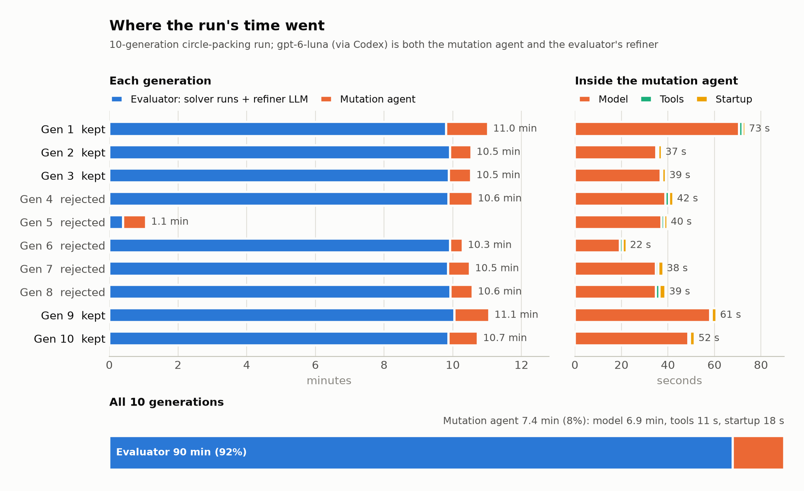

# Timing trace


Every `helix evolve` and `helix resume` appends a timing trace to
`.helix/timing.jsonl`, the same way it always records its budget; there is
nothing to turn on. `helix timing` reads it. Here it is on a 10-generation
run of the circle-packing example with one proposal per generation, so 11
candidates counting the seed, and Codex `gpt-6-luna` as the mutation agent:

```console
$ helix timing
                    Work by kind and candidate fate
┏━━━━━━━━━━━━┳━━━━━━━━━━┳━━━━━━━━━━┳━━━━━━━━━━━┳━━━━━━━━━━━━━━┳━━━━━━━┓
┃ Kind       ┃ Accepted ┃ Rejected ┃ Undecided ┃ Unattributed ┃ Total ┃
┡━━━━━━━━━━━━╇━━━━━━━━━━╇━━━━━━━━━━╇━━━━━━━━━━━╇━━━━━━━━━━━━━━╇━━━━━━━┩
│ evaluator  │   49m44s │   40m00s │      0.0s │         0.0s │ 1h29m │
│ agent      │    4m22s │    3m01s │      0.0s │         0.0s │ 7m24s │
│ git        │     1.1s │     2.1s │      0.0s │         0.0s │  3.1s │
│ state save │     0.0s │     0.0s │      0.0s │         0.0s │  0.0s │
└────────────┴──────────┴──────────┴───────────┴──────────────┴───────┘
                  Inside agent and evaluator calls
┏━━━━━━━━┳━━━━━━━━━━━┳━━━━━━━┳━━━━━━━━━━┳━━━━━━━━━━┳━━━━━━━┳━━━━━━━┓
┃ Within ┃ Name      ┃ Calls ┃ Accepted ┃ Rejected ┃ Total ┃   Max ┃
┡━━━━━━━━╇━━━━━━━━━━━╇━━━━━━━╇━━━━━━━━━━╇━━━━━━━━━━╇━━━━━━━╇━━━━━━━┩
│ agent  │ model     │    10 │    4m09s │    2m45s │ 6m54s │ 1m11s │
│ agent  │ other     │    10 │     8.5s │     9.9s │ 18.4s │  2.7s │
│ agent  │ tool:exec │    97 │     4.6s │     6.4s │ 10.9s │  0.6s │
└────────┴───────────┴───────┴──────────┴──────────┴───────┴───────┘
Candidates: 6 accepted, 5 rejected, 0 undecided
Wall: 1h37m over 10 generations (mean 9m42s, slowest gen 9: 11m04s)
Work adds up across parallel proposal slots, so it can exceed wall time.
```

*Work* is the time spent on each kind of operation, grouped by what became of
the candidate it was for. Rejected candidates are timed exactly like accepted
ones, the same way their tokens are charged to the budget. Parallel proposal
slots each add their own work, so work can exceed wall time. Every duration
leaves out time the machine slept, so a closed lid doesn't count.

In this run, evaluation dominates, and the evaluator calls an LLM of its own.
Each evaluation runs the candidate's solver for up to 600 seconds, then asks a
refiner LLM (also `gpt-6-luna`, through Codex) to rewrite the code, and runs
the rewrite too. So "evaluator" time here includes that refiner, separate from
the mutation agent, whose 10 calls took about 7 minutes in total, almost all
of it waiting on the model.

<picture>
  <source media="(prefers-color-scheme: dark)" srcset="../images/helix-timing-dark.png">
  
</picture>

To see a run as a timeline instead, `helix timing --perfetto trace.json`
writes the trace in Chrome's trace format. Drag that file into
[ui.perfetto.dev](https://ui.perfetto.dev) (or `chrome://tracing`) to get one
track per thread: the parallel proposal slots, what each spent its time on, and
where siblings waited on each other. It's an optional viewer, not a
dependency; nothing is installed.

## Inside agent and evaluator calls

The second table splits each agent call, and anything you time yourself.

**Agent calls** are split using the backend's own transcript:
- `tool:<name>` is each tool call, from its start to its result.
- `model` is the rest of the transcript's time, when the agent was waiting on
  the model (thinking, writing, compacting, retrying).
- `other` is the call's time outside the transcript: CLI and MCP startup and,
  in sandboxed runs, container start plus HELIX copying the worktree into the
  sandbox and back (large repositories make this grow).

The transcript's timestamps are wall clock. If the machine slept during the
call, the transcript spans more time than the call did, so every tool interval
is scaled down by the same factor and the split still adds up to the call's
duration.

This works for `claude`, `codex`, `opencode` and `pi`. `cursor` (no timestamps) and
`agy` (step timestamps only, to the second) get one `unavailable` row rather
than a guess.

**Your own operations** are timed with `helix.timed`, which works in the
evaluator, its `extra_commands`, its child processes, the sandboxed evaluator
runner, and scripts the agent runs during a mutation (in the sandbox too):

```python
from helix import timed

with timed("sam3", example=example_id):
    masks = sam3(frame)

@timed("molmo")                       # sync or async functions
def point(image, query): ...

timed.record("owl-vit", 0.41)         # a duration measured elsewhere
```

Outside HELIX it does nothing, so the same code runs locally. Each call appends
one line, `{"name": "sam3", "seconds": 0.84, "example": "12"}`, to the file
named by `HELIX_TIMING_LOG`. Code in another language, or in an image without
`helix` installed, can write that line itself. HELIX totals the file per name
and example after each call, so a tool called thousands of times adds one record
per evaluation, not thousands. A duration that is not a finite number of
seconds is dropped.

- **GPU work:** a GPU call returns before its kernels finish, so time up to the
  point the result is used (`.cpu()`, `synchronize()`) or around the request to
  an inference server.
- **Other services:** a model served by a separate container or machine,
  including the `[evaluator.sidecar]` service, can't see `HELIX_TIMING_LOG`.
  Time the request where your evaluator makes it, or
  pass a latency the server reports to `timed.record`.
- **Overlap:** names can nest (`rollout` around `sam3`) and examples can run in
  parallel, so totals are per name and don't add up to the evaluator's time.

## Record format

One JSON object per line, flushed as written so a killed run keeps everything
it finished. Each operation is a *span* with a `start` and an `end` record:

```json
{"event": "start", "span": "evaluate", "span_id": "7d44…", "parent_span_id": "a1f0…", "run_id": "c93e…", "generation": 3, "candidate": "g3-s9", "wall_time": 1757400000.1, "thread_id": 6199, "attrs": {"candidate_id": "g2-s4", "split": "train", "examples": 8}}
{"event": "end", "span": "evaluate", "span_id": "7d44…", …, "duration_seconds": 12.2, "outcome": "ok"}
{"event": "decision", "candidate": "g3-s9", "accepted": false, "reason": "train-gate-rejected candidate", "generation": 3, …}
```

- `generation` and `candidate` say what the work was for. The example is the
  evaluation of parent `g2-s4` (`attrs.candidate_id`) that proposal `g3-s9`
  ran, so it counts as work for `g3-s9`.
- `parent_span_id` links the spans into a tree.
- `run_id` separates `evolve` from each later `resume` in the same file.
- `outcome` is `"ok"` or `"error"`; on error, `error_type` names the exception
  class, never its message.
- `detail` records hold the totals above, with `within` (`agent` or
  `evaluate`), `source` (`transcript` or `timed`), `name`, `example`, `count`,
  `seconds` and `max_seconds`.
- Each attempt at a candidate gets one `decision` record. A `resume` retries
  an interrupted attempt under the same candidate id, after recording the
  interrupted one as rejected, so each span counts toward the next `decision`
  for its candidate later in the file, and each attempt counts as a candidate
  of its own. Work with no later `decision` was still undecided when the run
  stopped, and a `start` with no `end` was in flight when the process died.

| span | measures | `attrs` |
| --- | --- | --- |
| `run` | the whole run, sidecar included | |
| `generation` | one iteration of the generation loop, sequential acceptance included | `generation` |
| `proposal` | one proposal slot: parent eval, mutation, child eval (slots run in parallel) | `candidate_id`, `parent` |
| `mutate` / `merge` / `seed` | producing one candidate, its agent call included | `merge`: `candidate_id`, `parents`; `seed`: `candidate_id` |
| `summarize` | the sibling-history change summary | |
| `agent` | one backend CLI call | `backend`, `model` |
| `cached_evaluate` | one cache-aware evaluation: worktree lock wait, cache lookup, evaluator run | `candidate_id`, `split`, and `examples` / `evaluation_phase` when set |
| `evaluate` | one evaluator subprocess, always inside a `cached_evaluate` | `candidate_id`, `split`, and `examples` / `evaluation_phase` when set |
| `validate` | one full-validation pass | `candidate_id` |
| `clone` / `snapshot` / `remove` | creating, committing, or removing a candidate worktree | `snapshot`, `remove`: `candidate_id` |
| `save_state` | one write of `state.json` and the eval-cache pickle (grows with the run) | |
| `sandbox_reset` | the per-generation sandbox state wipe (sandboxed runs only) | `backend` |

Because every record carries `generation` and `candidate`, your own questions
are flat queries. For example, agent seconds per generation:

```console
$ jq -s 'map(select(.event == "end" and .span == "agent")) | group_by(.generation) | map({gen: .[0].generation, seconds: (map(.duration_seconds) | add)})' .helix/timing.jsonl
```
