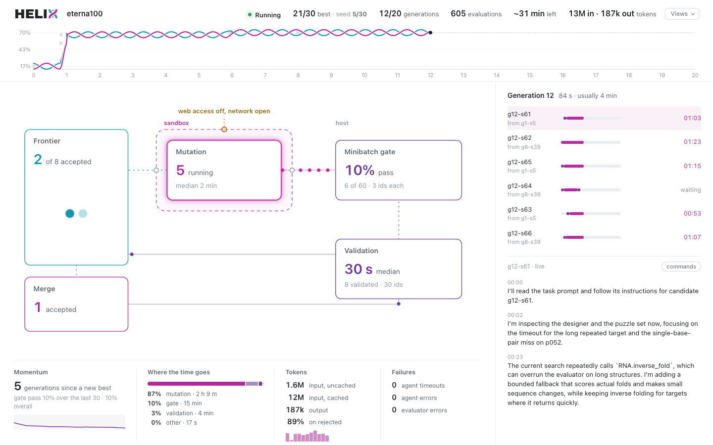

# Live dashboard

`helix ui` opens a read-only dashboard of a project in your browser. Before a run it shows the configured loop and where
each part runs; during and after a run it shows progress, the frontier, the lineage of every proposal, a table of all
proposals, every candidate, the current generation with the agent's live transcript, and run health. It reads
`helix.toml` and `.helix/`, the same files `helix log`, `helix frontier` and `helix timing` read, and never writes to
them.

```console
$ helix ui
HELIX UI for my-project: http://127.0.0.1:8790/?token=Ux3kQ9vN2pLm7RtA5yWc8dEf1HgJ4sZb
Read-only. Press Ctrl+C to stop.
```

<picture>
  <source media="(prefers-color-scheme: dark)" srcset="../assets/ui/helix-ui-dark.png">
  
</picture>

## Options

```
--dir PATH        Project directory containing helix.toml (default: .)
--config PATH     Path to the config file (default: helix.toml)
--port INT        Port to listen on (default: 8790; the next 10 are tried when it is taken)
--host HOST       Interface to listen on (default: 127.0.0.1)
--no-browser      Print the address without opening a browser
```

## A run on another machine

Start the dashboard where the run is and forward its port:

```bash
ssh my-server 'cd ~/my-project && helix ui --no-browser'
ssh -N -L 8790:127.0.0.1:8790 my-server
```

Then open the printed address on your machine. Keep `--host` at its default: the dashboard serves validation scores and
evaluator feedback, and anything other than loopback exposes them to the network.

## Views

The **Views** menu at the top right switches between the Loop, Frontier, Lineage and Proposals. With the menu open, the
arrow keys, Home and End move through it and Escape closes it; Down on the Views button opens it. Elsewhere, Escape
closes the open popover or panel, and otherwise returns to the Loop. Each view has its own address, such as
`#proposals/rejected`, `#lineage/g12-s3` or `#candidate/g12-s3`, so a link to it opens that view.

## What it shows

- **Header**: run state, the best validation score (successes out of n when every score is 0 or 1) with the seed's score
  beside it, generations, evaluations against `max_evaluations`, time left from whichever limit binds first, and spend,
  with the projected total at the end while the run is going. With an `objective`, `hybrid` or `cartesian` frontier the
  best of each objective takes the place of the single score: the first three are shown, and hovering or clicking them
  lists every objective with the candidate that holds its best and the seed's value. Codex reports no cost, so a Codex
  run shows tokens instead. Click the project name for the config hash, `frontier_type`, `rng_seed`, agent, evaluator
  command and sandbox.
- **Progress**: the best validation score by generation, drawn as a helix around it, with a rung at each new best and a
  dot for every accepted candidate. Hover for the generation and the candidate that held the best. On a run with
  objectives, a selector on the chart switches the line from the aggregate to one objective's best so far; the browser
  remembers the choice. Click the chart's background to open the Lineage.
- **Loop**: frontier, mutation, minibatch gate and validation, each with one live number. Arrows move at the speed of the
  run's own median durations. The sandbox is drawn when the agent runs in Docker; the evaluator sits outside it unless
  it runs in a sidecar. Amber marks only settings that are likely mistakes, such as `agent.web_access = false` with an
  open network or a shared login volume. Click the gate for the rejected proposals.
- **Frontier** (click the box): the non-dominated candidates (GEPA's `remove_dominated_programs` over the frontier
  keys), their mean score against the keys they hold, and a strip of the best score on every validation instance. Click
  a cell of the strip for that instance's score in every accepted candidate. With an `objective`, `hybrid` or
  `cartesian` frontier it shows a table of objective means and a plot of one objective against another.
- **Lineage**: every proposal by generation, joined to its parents, with the path to the best candidate in cyan,
  frontier members ringed and rejected proposals as small open dots (shown up to 400 nodes; a toggle turns them on or
  off). Hover a node to light its ancestors and descendants and fade the rest. Click it to pin it and open its panel:
  generation and parents, score (labelled `val` or `gate`), outcome and reason, objective values, the change summary,
  how many descendants it has and how many of them were accepted, and its children. Double-click a node, or use "Open
  candidate", to open it. While a node is pinned, Left moves to its parent, Right to its best child, and Up and Down to
  its neighbours in the same generation; Escape unpins it. `#lineage/<id>` opens the view with that node pinned.
- **Proposals**: one row per proposal in `helix log` order, including perfect-score skips, failed proposals and the ones
  still running. Filter by outcome (frontier, dominated, rejected, skipped, failed, running) and sort by generation,
  score, Δ parent or cost. A score labelled `val` is an accepted candidate's validation mean; one labelled `gate` is
  where a rejected proposal stopped, on the minibatch or the val stage (for a skip, the parent's minibatch score). Δ
  parent compares validation means, so only accepted candidates have one. The cost column (tokens for Codex) appears
  when the run has `usage` records. Up, Down, Home and End move the selection, and Enter opens it.
- **Candidate** (click any dot, rung or row): its generation and parents, score, frontier rank and objective means, and
  how many validation instances it solved (`improved` when scores are not 0 or 1) or regressed against its parent. Then
  its worktree and commit, the files changed and the diff against its parent, or against the seed with the `vs seed`
  switch; the agent's change summary; its time in mutation, gate and validation and what it cost (tokens for Codex);
  its children with their outcome and score; and, under **Task prompt**, the prompt the mutation agent was given. A
  rejected candidate also shows why and where it stopped.
- **Instances** (on the Candidate): every scored instance, in three tabs. **Changed** holds the instances whose score
  differs from the parent's, improved first; the solved and regressed counts open it in that direction. **All** keeps
  the evaluation order and **Lowest** puts the lowest first. Click a row for the evaluator's side information on that
  instance for the candidate and its parent, and the instance's score in every accepted candidate. When the instance ids
  fall into two or more families (the text before `group_key_separator`), a **Families** table compares the candidate
  with its parent per family, and a click on a family filters the instances to it. A rejected candidate's instances are
  its gate scores, labelled `gate`.
- **Mutation** and **Validation** (click the box): the agent's time by tool, and the evaluator's command, sizes, errors and
  the time of each [`helix.timed`](timing.md) name it reports.
- **Run health**: generations since a new best and the gate pass rate, where the time goes, spend, and failures (agent
  timeouts, agent errors, evaluator errors; click a count for the failed proposals). Spend is the cost so far and a
  projected cost at the end. A run that writes `usage` records to [`.helix/timing.jsonl`](timing.md#record-format) also
  shows a bar of cost per generation and the share spent on proposals that were rejected or failed, and projects from
  the median cost of a finished generation; an older run projects from the run total divided by the generations so far.
  Codex reports no cost, so a Codex run shows the bars and the share in tokens, with no projection.
- **Current generation**: each proposal's phase and elapsed time, and the live transcript of the selected agent.

## Live transcripts

The transcript comes from the agent CLI's own session file, which Codex and Claude Code write as they run. With the
Docker sandbox on, that file is in the run's login volume, so the dashboard reads it with a short-lived container that
mounts the volume read-only and has no network, at most once every 4 seconds and only while the transcript is on
screen. HELIX does not record which session belongs to which agent until the call ends, so a live session is matched to
its agent by start time. After a call ends the dashboard shows the copy HELIX keeps in the candidate's worktree; rejected
candidates' worktrees are removed, and their transcripts with them. Transcripts are shown for the `codex` and `claude`
backends; other backends show none.

## Safety

- The dashboard only reads: it never writes to the project, `.helix/`, worktrees, git refs or Docker volumes, and it
  never reads credential files.
- Secrets that look like API keys or tokens are masked everywhere they could appear, and environment variables are shown
  by name only.
- Every request needs the token from the printed address. A sandboxed agent with `add_host_gateway` can reach ports on
  the host, and the token keeps it from reading scores or evaluator feedback from the dashboard.

## Limits

- HELIX writes no "finished" marker other than the end of the run's timing span, so a run killed with `SIGKILL` looks
  like it is still running. The dashboard marks a run that has written nothing for a long time as "Running?".
- Tokens and cost are added to the run's budget when an agent call ends, so spend lags the live transcript.
- A run older than the `usage` records has no per-generation bars, no cost per proposal and no share on rejected
  work. The Candidate view then takes the cost from the backend's result files in the worktree, which go with a
  rejected candidate's worktree.
- The parent's score on the minibatch gate is not saved, so a rejected proposal shows the child's score only.
